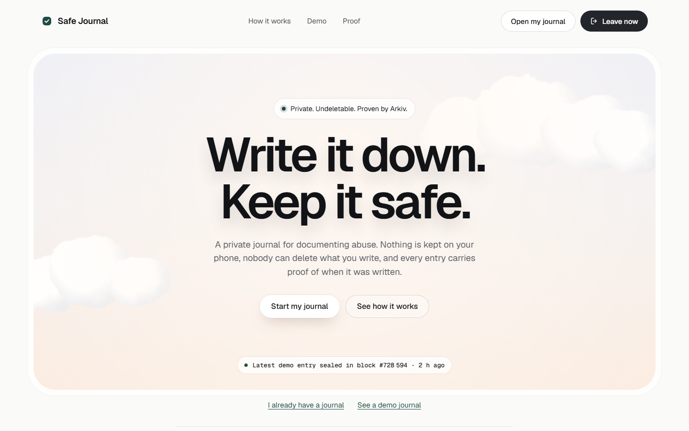

<p align="center">
  
</p>

<h1 align="center">Safe Journal</h1>

<p align="center"><b>Write it down. Keep it safe. Make it count.</b><br>A private journal for documenting abuse. Nothing is kept on your phone, nobody can delete what you write, and every entry carries proof of when it was written.</p>

<p align="center">
  <a href="https://safe-journal-seven.vercel.app"></a>
  <a href="https://safe-journal-seven.vercel.app/#/proof"></a>
  <a href="https://github.com/jenzylove/safe-journal/actions/workflows/ci.yml"></a>
  
  
  
</p>

<p align="center">
  <a href="https://safe-journal-seven.vercel.app"></a>
</p>

Everyone who supports people living with abuse gives the same advice: write down what happens, with dates, so a lawyer or a court will believe you later. Safe Journal makes that safe to do. Entries are encrypted in your browser and written to Arkiv in one transaction that hands them to an address nobody controls. From that moment, the time an entry was written is a block time anyone can check, and nobody can delete or change it: not you under pressure, not someone holding your phone, not us.

## Start here

| | |
|---|---|
| Use it (start a journal in a private tab) | [safe-journal-seven.vercel.app](https://safe-journal-seven.vercel.app) |
| Open the demo journal, exactly as a lawyer sees it | [/#/demo](https://safe-journal-seven.vercel.app/#/demo) |
| Every claim checked live from Arkiv | [/#/proof](https://safe-journal-seven.vercel.app/#/proof) |
| Watch the demo (2:48, recorded on the live site) | [safe-journal-demo.mp4](https://github.com/jenzylove/safe-journal/releases/download/v1.0/safe-journal-demo.mp4) |
| The data contract: entities, attributes, lifetimes, queries | [arkiv/schema.md](arkiv/schema.md) |
| Reproduce it from a terminal | `npm install && node scripts/verify.mjs` |
| The same app on a second, independent host (GitHub Pages, no server of ours) | [jenzylove.github.io/safe-journal](https://jenzylove.github.io/safe-journal/) |
| Read a journal with no website at all | [reader/safe-journal-reader.html](reader/safe-journal-reader.html) |
| Friction report | [arkiv/friction.md](arkiv/friction.md) |
| Build log, spikes, PRD | [docs/](docs/) |

## The problem

About one in three women worldwide has experienced physical or sexual violence, most often from a partner ([WHO, 2021](https://www.who.int/news/item/09-03-2021-devastatingly-pervasive-1-in-3-women-globally-experience-violence)). Writing it down is how a case gets built, and it is hard to do safely:

- **The phone gets checked.** Notes, a gallery of injuries, a journal app on the home screen: if they are found, things can get worse.
- **The dates get doubted.** "You wrote all of this afterwards." A note's date is whatever the phone says, and an app's timestamp is that company's word.
- **The evidence lives with someone else.** Apps built for this keep it on their own servers. When one of them shut down in 2023, its users were told to move their evidence out themselves.

## Why these three pillars

**Privacy.** *Who is exposed today:* a person whose partner checks her phone, and whose evidence otherwise sits in a notes app, a gallery, or an operator's servers. *What changes on day one:* nothing about the journal is on her phone; Arkiv shows four labels and ciphertext, never her words, photos, names or the times she gave; each entry lives for the lifetime she picks; a link opens only the entries she chooses. What the public record does reveal (that an address writes entries, and when) is set out in the [threat model](SECURITY.md#threat-model).

**Security.** *Who is misled today:* a court or an advocate told "she wrote all this afterwards", or shown a planted message under her name ("I made all of this up"). *What changes on day one:* every entry's time is the Arkiv block it was created in, every read trusts only `createdBy(journal)`, and anything carrying her journal's label but written by another wallet is shown as rejected, live, in the lawyer view.

**Censorship Resistance.** *Who is cut off today:* survivors whose evidence app shuts down or is taken offline; one shut down in 2023 and told its users to move their data out themselves. *What changes on day one:* the journal is read straight from an Arkiv node. The same app also runs as a mirror on GitHub Pages, which opens the demo journal contacting only github.io and the Arkiv node, and a one file reader can point at any node. No server of ours is needed to read, and anyone can fund a journal from the public faucet if our funding endpoint is gone.

## How it works

1. **Choose six words.** Your journal opens with a passphrase only you know. No account, no email, no phone number. Keys are made from it in your browser and never leave it.
2. **Write what happened.** Text, the time you say it happened, a category and an optional photo. The photo is redrawn on this device, which strips its location data. Everything is encrypted before it leaves the browser.
3. **Each entry is sealed.** One Arkiv transaction creates the entry and hands it to a burn address, so it can never be deleted or changed. Every entry shows the block it was sealed in: proof of when, which nobody can backdate.
4. **Share when you are ready.** Every entry has its own key. A link for your lawyer opens only the entries you choose, with a printable timeline of proven times, creating transactions and lifetimes. The key leaves the address bar the moment the page loads.
5. **It outlives this website.** A single file reader opens any journal straight from Arkiv.

If someone forces you to open your journal, a second passphrase opens an everyday journal of ordinary notes instead. Nothing in the journals links them (setting both up minutes apart could, which the app says).

Entries live exactly as long as you choose (1, 2, 5 or 10 years). Only if you tick "Let my lawyer keep this entry longer" can anyone extend one.

## Why only on Arkiv

Safe Journal needs one record with three properties at once. Arkiv is the only place we found all three as protocol features rather than code we would have to write and run.

1. **Anyone can read it by its proven author, across years, with no server.** `createdBy(journal)` is the whole read path of the app, the lawyer view and the one file reader. It goes straight to an Arkiv node: no indexer, no API of ours, nothing to shut down.
2. **Nobody can delete or edit it.** The creating batch hands every entry to `0x…dEaD` and marks it `readonly`, in the same transaction. Not us, not the person under pressure, not someone holding her phone.
3. **It lives for a lifetime she picks, which nobody can shorten, and which her lawyer can extend without any key, but only if she allowed it.** That is Entity Expiration plus Lifetime Extension with the permissionless flag set per entry, a rule the chain itself enforces.

Take Arkiv away and something important breaks:

| Instead of Arkiv | What breaks |
|---|---|
| Our own server or Postgres | The write time is our word, we can delete, and the evidence dies with us. One evidence app for survivors already shut down and told its users to move their data out themselves |
| A timestamping service (OpenTimestamps) | The time is proven, but the evidence itself still has to live somewhere: on the phone that gets checked, or with an operator |
| Arweave | Permanent and timestamped, so it cannot honour a lifetime she chooses, and it has no per entry permission for a lawyer to extend one. Reads by author go through a gateway's index |
| IPFS | No proven time, no queries, and someone has to keep pinning it |
| A custom contract on any chain | It can be made undeletable and timestamped, but we would have to design its storage, write its read path, deploy and own it, and build lifetimes and a permission to extend ourselves. Arkiv gives those as protocol features: entity lifetimes, a per entity permissionless extension flag, `createdBy` reads straight from a node, and readonly entities |

Cost: an entry costs about 0.0001 test GLM, an entry with a full size photo about 0.002 (measured on Tiramisu, see `docs/spikes`).

Kept off Arkiv on purpose: the passphrase, every key, all plaintext, the original photo and its metadata, and anything that identifies the person. One honest line: when an entry expires it leaves Arkiv's state, but its ciphertext stays in the chain's history, so privacy rests on the key, never on expiry.

### Every Arkiv feature, and what the person sees

| Arkiv feature | What the person sees |
|---|---|
| Atomic `executeBatch` with `ownershipChanges` and the `readonly` flag | "Owner: burn address, cannot be deleted" on every entry, from the first second; nothing can be edited |
| `$createdAt` block | "Sealed · block #…" and "Written at" next to "You said it happened" |
| `createdBy(journal)` vs the writable `journal` label | A planted "I made it all up" entry carrying the journal's label is shown under "Not from this journal" as rejected |
| Entity Expiration, chosen per entry | "How long to keep it": 1, 2, 5 or 10 years, and nobody can shorten it |
| `permissionlessExtension` (opt in) and `extendEntity` | "Let my lawyer keep this entry longer" when writing; "Keep this entry one more year" in the lawyer view, paid by a throwaway key |
| Attributes vs payload | The explorer shows four labels and ciphertext, never the person's words, photos or names |
| `watchEntityEvents` over WebSocket | New entries appear in an open journal and in an open lawyer view without a refresh |

## What is live

| Part | Status |
|---|---|
| App, every screen | Live at [safe-journal-seven.vercel.app](https://safe-journal-seven.vercel.app) |
| Writes, reads, live updates | Arkiv Tiramisu testnet (chain 7738577), from the browser |
| Funding new journals | A small endpoint tops up a journal address with test GLM after a proof of work on the device. New addresses get one top up; refills only after real writes. It receives an address and the proof; the connection address is used for a rate limit in memory and never stored. Anyone can also fund a journal from the public faucet |
| Demo journal | Synthetic entries, a forged look alike and a third party extension, all on chain ([evidence](arkiv/evidence.json)) |
| Tests | Unit tests, a real chain integration test, and Playwright tests of the live flows |

Safe Journal runs on Arkiv's testnet, and all data in this repository and the demo is synthetic. A proven time shows when an entry was written, not what happened; courts weigh it alongside other evidence. What the public record does and does not reveal is set out in the [threat model](SECURITY.md#threat-model).

## Run it

```bash
npm install
npm run dev              # app on localhost:5173
npm test                 # unit tests
CHAIN=1 npm test         # plus the Tiramisu integration test (needs ARKIV_PRIVATE_KEY in .env)
npm run e2e              # Playwright
npm run build:all        # app and the single file reader
```

## Built with

Arkiv TypeScript SDK 0.8.1, viem, Vite and TypeScript, Argon2id (hash-wasm), noble curves and hashes, Web Crypto (AES-256-GCM), Playwright, Vercel.

## License

MIT
